# Saúde+: *system design* (etapa 7.2)

| | |
|---|---|
| **Status** | Rascunho para revisão (etapa 7.2 da Fase 7) |
| **Criado em** | 2026-11-01 |
| **Commit de referência** | `8f8f8f0` (branch `stabilize/fase-0-1`) |
| **Método** | Leitura direta do código (rotas, serviços, repositórios, middlewares, jobs, scripts e o front). O grafo (`graphify-out/GRAPH_REPORT.md`) serve de apoio na 7.3, não aqui. |
| **Escopo** | Descreve o sistema **como está**. Não propõe mudanças: os achados e as decisões ficam para 7.3 a 7.5. |

> Convenção: o que está marcado como **Observação** é um fato lido no código que parece relevante para a análise. Não é veredito. A 7.3 confirma cada um com o grafo e a 7.5 decide a classe (remover, editar, criar, manter).

## 1. Contexto

Quem usa o sistema e com quais sistemas externos ele conversa.

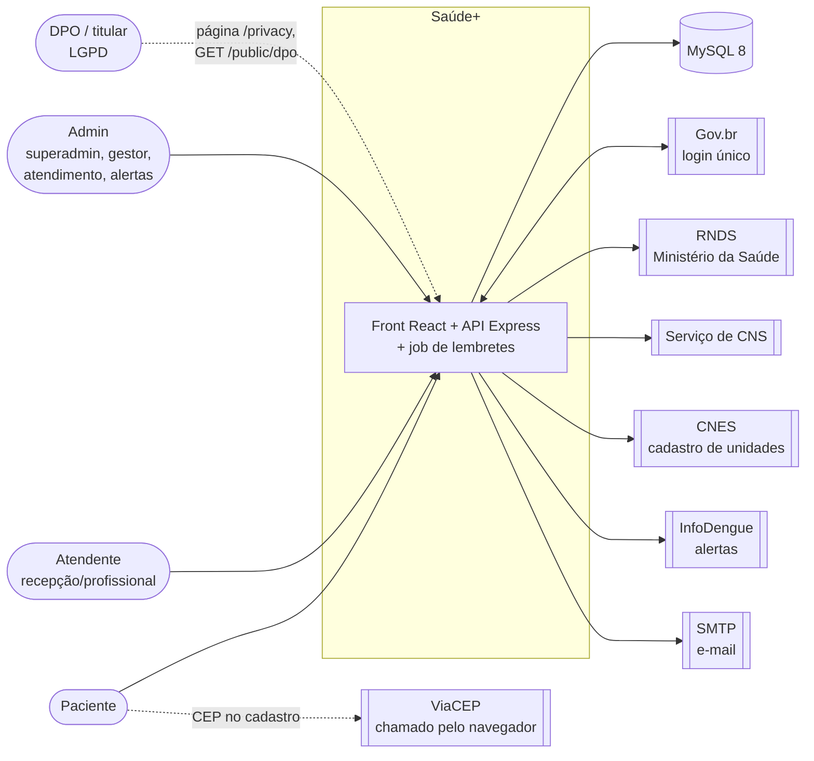

| Sistema externo | Para que | Onde no código | Obrigatório? |
|---|---|---|---|
| Gov.br | Login único (OAuth) | `services/govbr.js`, `routes/auth.routes.js` (`/auth/govbr/*`) | Opcional (variáveis `GOVBR_*`) |
| RNDS | Enviar dados clínicos ao Ministério da Saúde | `services/rnds.js`, `POST /interop/rnds/send` | Opcional (`RNDS_*`, certificado) |
| Serviço de CNS | Consultar o Cartão Nacional de Saúde | `services/cns.js` | Opcional (`CNS_WS_*`) |
| CNES | Sincronizar unidades de saúde | `services/cnes.js`, `scripts/sync-cnes.js` | Opcional, rodado à mão |
| InfoDengue | Alertas de doenças | `services/infodengue.js`, `scripts/sync-alerts.js` | Opcional, rodado à mão |
| SMTP | Lembretes, redefinição de senha, aviso de vaga | `services/mailer.js` | Opcional; sem SMTP o lembrete fica registrado e não é enviado |
| ViaCEP | Preencher endereço no cadastro | `web/src/lib/viacep.ts` (o navegador chama direto; a CSP libera só este host) | Opcional |

**Papéis (`users.role`):** `paciente`, `atendente`, `admin`. O admin tem um nível (`admin_level`): `superadmin`, `gestor`, `atendimento`, `alertas`, e cada nível concede capacidades (`middleware/capabilities.js`: `users`, `appointments`, `diseases`, `units`, `audit`, `reports`, `admins`).

## 2. Contêineres

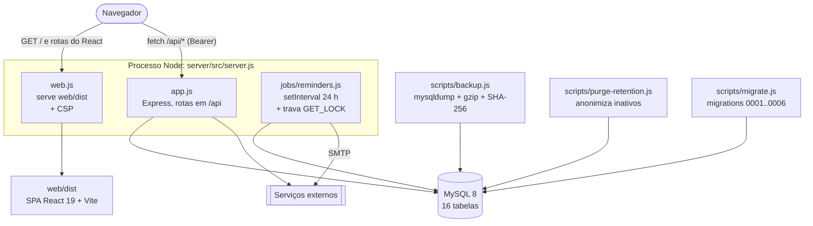

Pontos que definem a forma do sistema:

- **Origem única** (ADR-0002): em produção o Express serve o build do Vite e a API em `/api`. Sem `SERVE_WEB`, a API também responde na raiz (`/auth`, `/admin`…); esse caminho existe por causa do front legado (ADR-0003 o aposenta).
- **Instância única com tolerância a réplicas:** o job de lembretes roda dentro da API. A trava `GET_LOCK` (`utils/jobLock.js`) impede execução duplicada se houver mais de uma réplica.
- **Estado em memória:** limites de login (`loginAttempts`), tentativas de MFA e o limitador de requisições vivem na memória do processo. Com mais de uma réplica, cada uma conta por conta própria.
- **Sem fila, cache nem armazenamento de arquivos.** Tudo que persiste está no MySQL, exceto os backups em disco.
- **Operação:** `GET /health` (vivo) e `GET /ready` (alcança o banco, expõe `audit_lock`). O `server.js` recusa subir sem chaves de cifra e HMAC do CPF, sem `JWT_SECRET` de 32+ caracteres ou sem as colunas obrigatórias.

**Observação:** `process.env` é lido espalhado em ~15 módulos, sem um ponto único de configuração. Ver 7.4 (operação).

## 3. Componentes da API

### 3.1 Camadas

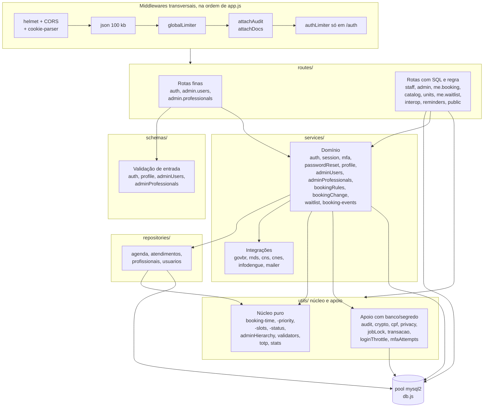

Duas famílias de rota convivem:

| Família | Rotas | Como é feita |
|---|---|---|
| **Fina** (alvo da A1/A2) | `auth` (254 linhas), `admin.users` (91), `admin.professionals` (105) | Valida com `schemas/`, chama um serviço, traduz o resultado em HTTP e auditoria. Sem SQL. |
| **Gorda** (ainda por refatorar) | `staff` (590), `admin` (427), `me.booking` (309), `catalog` (152), `units` (148), `me.waitlist` (101), `interop` (101) | SQL direto com `pool`, regra e resposta no mesmo arquivo. |

### 3.2 Núcleo de agendamento

É o centro do sistema: tudo que grava ou lê agenda passa por aqui.

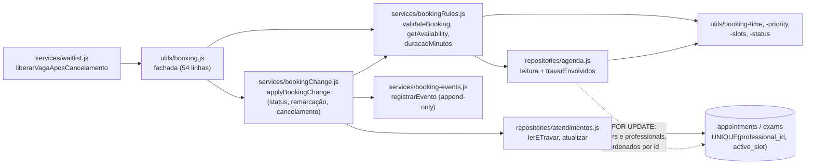

**Três defesas contra horário duplo**, em camadas:
1. **Travas:** `travarEnvolvidos` faz `SELECT … FOR UPDATE` no usuário e no profissional, sempre ordenados por id (evita deadlock).
2. **Validação na mesma transação:** `validateBooking` lê os horários ocupados já sob a trava.
3. **Banco:** `UNIQUE (professional_id, active_slot)`, em que `active_slot` é o horário só enquanto o atendimento está pendente ou confirmado (coluna gerada, migration 0005). Se as duas primeiras falharem, o MySQL recusa e `app.js` devolve 409 "Horário já ocupado" (`utils/dbErrors.js`).

**Observações:**
- Há **três** pontos que gravam agendamento novo e repetem o mesmo `INSERT` montado à mão: `routes/me.booking.routes.js` (paciente), `routes/staff.routes.js` (recepção, `createStaffBooking`) e `services/waitlist.js` (`tentarPreencher`). Os três usam as travas e `validateBooking`, mas o texto do `INSERT` é triplicado.
- `me.booking.routes.js` (`POST`, `PUT`, `cancel`) **não grava no `audit_log`** e só registra evento de agenda (`booking_events`) no reagendamento; criar e cancelar pelo paciente não geram evento. Os caminhos de staff e admin passam por `applyBookingChange`, que registra evento e devolve os dados para a auditoria.
- `PATCH /me/.../cancel` não usa transação (`UPDATE` condicional + liberação de vaga depois, com erro engolido no log).
- A fachada `utils/booking.js` depende de `services/` (util apontando para serviço); `services/waitlist.js` importa a fachada, e a fachada importa `bookingChange`, que importa `bookingRules`. Não há ciclo real (o grafo acusou `booking.js → booking.js`, mas é artefato).

### 3.3 Segurança e controle de acesso

| Camada | Mecanismo | Onde |
|---|---|---|
| Autenticação | JWT de acesso (15 min) em `Authorization: Bearer`; refresh token opaco (30 dias) com rotação e detecção de reuso por "família" | `middleware/auth.js`, `services/session.js` |
| Segundo fator | TOTP (RFC 6238) com segredo cifrado, replay bloqueado por `totp_last_step`, ticket de 1ª etapa | `services/mfa.js`, `utils/totp.js`, `utils/mfaAttempts.js` |
| Autorização | Papel (`requireAdmin`, `requireStaff`) e capacidade por nível (`requireCapability`, **falha fechada**) | `middleware/auth.js`, `middleware/capabilities.js` |
| Hierarquia de admins | Ator não cria nem edita nível acima do próprio; conta própria não muda status nem papel | `utils/adminHierarchy.js`, `services/adminUsers.js` |
| Escopo do atendente | Atendente vinculado a um profissional enxerga só a agenda dele (em parte das rotas) | `routes/staff.routes.js` (`getLinkedProfessionalId`) |
| Limites | `globalLimiter` 300 req/15 min, `authLimiter`, `readinessLimiter`; bloqueio de login por IP+conta | `middleware/rateLimit.js`, `utils/loginThrottle.js` |
| Auditoria | Cadeia de hash encadeada em `audit_log`, mutex `GET_LOCK`, nunca derruba a requisição; `GET /admin/audit-log/verify` confere a cadeia | `utils/audit.js`, `middleware/audit.js` |
| Cifra de dados | AES-256-GCM em CPF, RG, CNS e `totp_secret`; HMAC-SHA-256 do CPF (`cpf_hmac`) como índice cego | `utils/crypto.js`, `utils/cpf.js`, ADR-0006 |
| Cabeçalhos | `helmet` (CSP com `connect-src` para ViaCEP); CORS por lista explícita | `app.js`, `web.js` |

**Observações:**
- A auditoria é chamada **à mão** em cada rota (`req.audit(...)` ou o middleware `audit(...)`). Não há garantia estrutural de que toda escrita seja auditada: 7 arquivos de rota chamam a auditoria; `me.booking`, `me.waitlist`, `catalog` e `reminders` não.
- O login por senha (`POST /auth/login`), o cadastro, a exportação (`GET /auth/me/export`) e a edição de perfil não geram linha de auditoria nas rotas. A anonimização grava `lgpd_delete` dentro de `utils/privacy.js`.
- O escopo do atendente não vale em `GET /staff/agenda/reports` e `GET /staff/booking-events` (decisões já pendentes no plano do 3B).
- O JWT de acesso e o refresh token ficam em `localStorage` no front (`web/src/lib/session.ts`), e o servidor devolve o refresh também no corpo da resposta, além do cookie `saude_refresh`. O cookie existe, mas o front usa o valor do `localStorage`. Isso expõe os dois tokens a qualquer XSS; a 7.4 avalia.

### 3.4 Rotas por papel (resumo do inventário)

| Prefixo | Papel mínimo | Arquivo | Observação |
|---|---|---|---|
| `/auth/*` | público + `verifyToken` | `auth.routes.js` | 16 rotas: cadastro, login, MFA, redefinição, refresh, Gov.br, perfil, exportação, exclusão |
| `/me/appointments`, `/me/exams` | autenticado | `me.booking.routes.js` (fábrica por tipo) | `appointments.routes.js` e `exams.routes.js` têm 6 e 5 linhas |
| `/me/waitlist`, `/me/reminders` | autenticado | `me.waitlist.routes.js`, `reminders.routes.js` | |
| `/catalog/*` | autenticado | `catalog.routes.js` | ofertas, profissionais, disponibilidade, horários |
| `/health-units` | autenticado; gestão exige admin + `units` | `units.routes.js` | |
| `/diseases` | autenticado | `diseases.routes.js` | leitura |
| `/staff/*` | atendente ou admin | `staff.routes.js` | agenda, criação pela recepção, pacientes, relatórios, eventos |
| `/admin/users`, `/admin/professionals` | admin + capacidade | rotas finas + serviços | |
| `/admin/*` (resto) | admin + capacidade | `admin.routes.js` | estatísticas, CSV, listagens, doenças, fila, auditoria |
| `/interop/*` | status aberto; envio exige `reports` | `interop.routes.js` | |
| `/public/*` | sem login | `public.routes.js` | estatísticas e dados do DPO |

## 4. Front

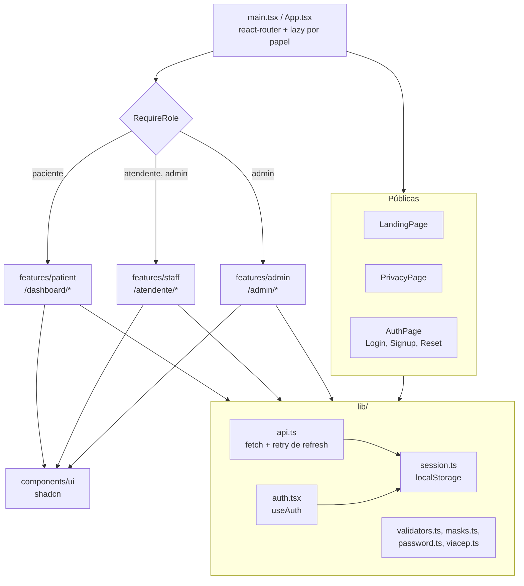

- **Pilha:** React 19, Vite, TypeScript, Tailwind v4, shadcn (ADR-0001). Cada área (`patient`, `staff`, `admin`) é carregada sob demanda com `lazy`.
- **Contrato com a API:** implícito. `api.ts` expõe `get/post/put/patch/delete` genéricos, e os tipos de resposta são escritos à mão em cada feature. Não há esquema compartilhado nem OpenAPI.
- **Espelho de regra:** `web/src/features/admin` tem um mapa de capacidades por nível que um teste compara com `middleware/capabilities.js` (única duplicação protegida por teste).
- **Sessão:** `api.ts` anexa `Authorization: Bearer`, e em 401 tenta `POST /auth/refresh` uma vez antes de repetir (exceto nas rotas de credencial).
- **Testes:** Vitest (339 casos) no `web/`; Playwright em `e2e/` (28 casos, banco descartável).

## 5. Sequências dos fluxos críticos

### 5.1 Cadastro, login, MFA e Gov.br

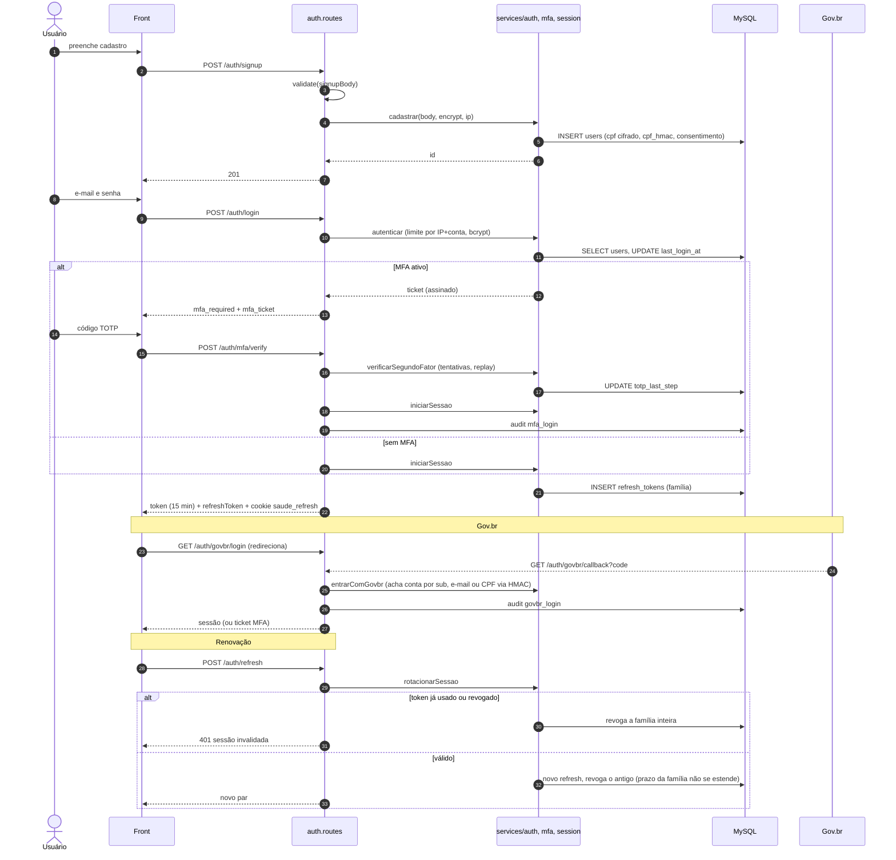

### 5.2 Agendamento pelo paciente

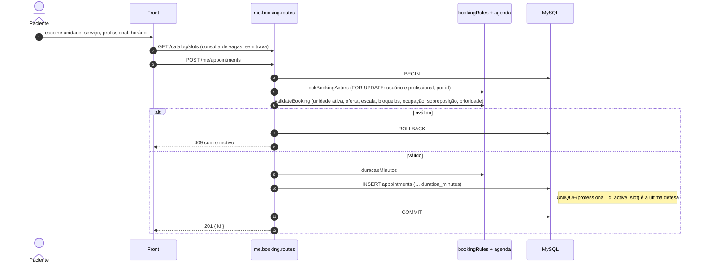

A recepção (`POST /staff/appointments|exams`) segue a mesma sequência com a trava e a validação, mas o paciente é escolhido pelo atendente e há escopo por profissional.

### 5.3 Remarcação, cancelamento e liberação de vaga pela fila

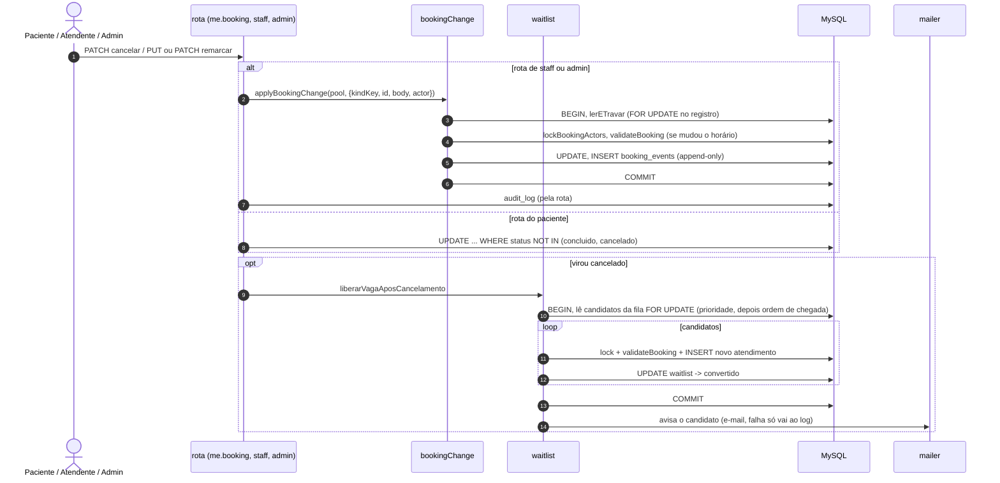

**Desativação de profissional** (`services/adminProfessionals.atualizarProfissional`): transação única; o profissional é travado, os atendimentos futuros dele passam para "a remarcar" (`moverAtendimentosParaRemarcar`), e **depois do commit** `avisarPacientes` envia o aviso por e-mail. A fila de espera não é acionada nesse caminho.

### 5.4 Lembretes

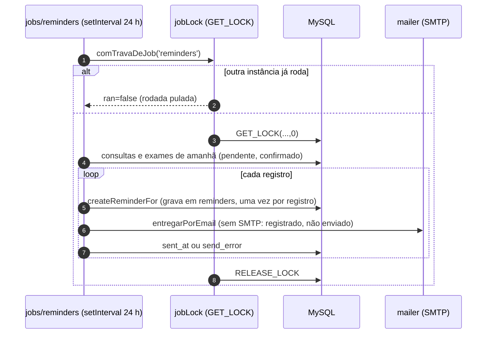

A primeira execução acontece **na subida** da API (`execute()` antes do `setInterval`); as seguintes, a cada 24 h após a subida, não em horário fixo.

### 5.5 Exportação e exclusão (LGPD)

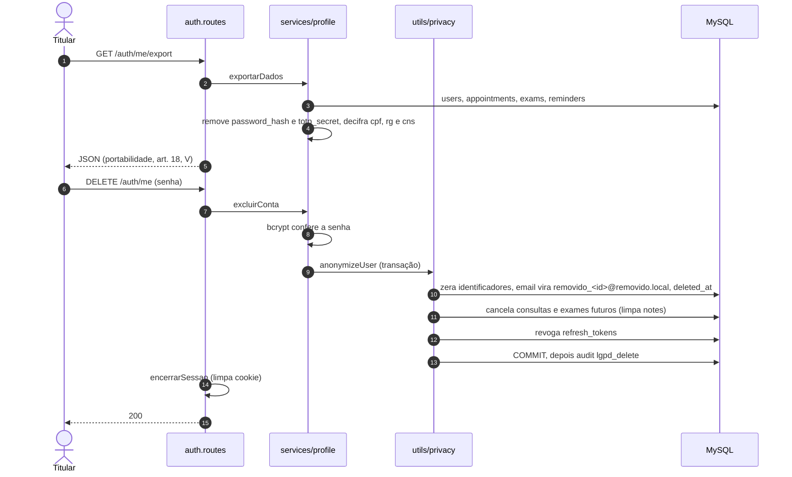

Retenção: `scripts/purge-retention.js` (manual, `--apply`) anonimiza pacientes sem login há mais de 5 anos e apaga refresh tokens vencidos há mais de 90 dias. **Nada o agenda**: depende de alguém rodar.

## 6. Fluxo de dados pessoais

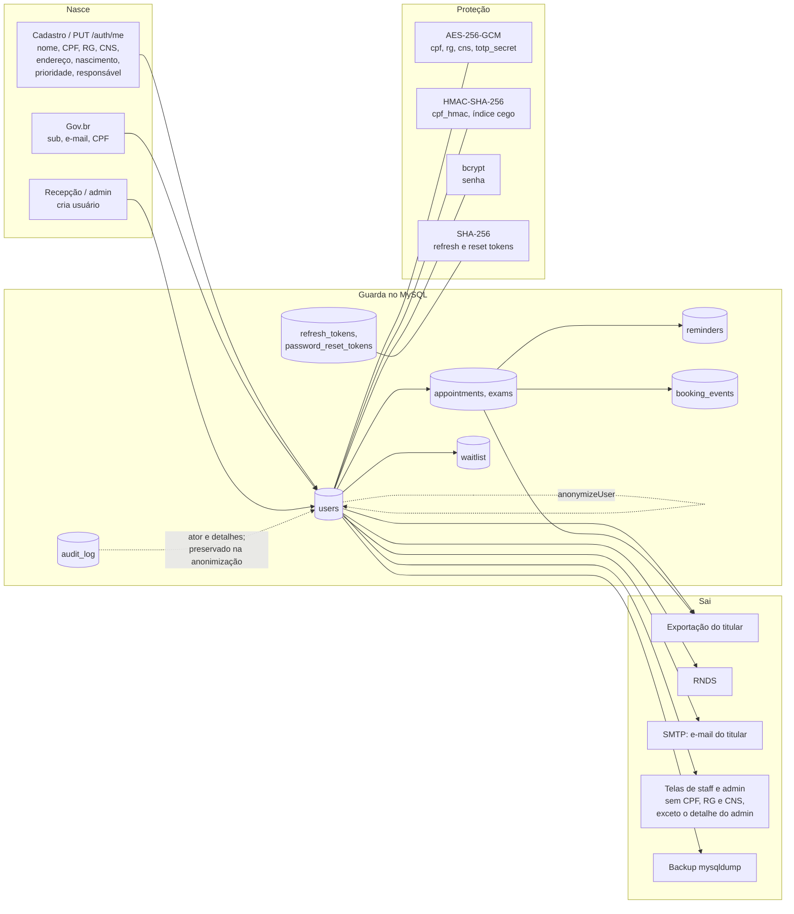

| Dado | Cifrado? | Índice | Quem vê | Eliminação |
|---|---|---|---|---|
| CPF | Sim (AES-GCM) | `cpf_hmac` (busca e unicidade) | O titular (`GET /auth/me`, decifrado, sem máscara); o admin no detalhe individual (`GET /admin/users/:id`, decifrado e **auditado**); `POST /interop/rnds/send` decifra para enviar à RNDS. Listas e rotas de staff não selecionam o campo | Zerado na anonimização |
| RG, CNS | Sim | Nenhum | Idem | Zerado |
| `totp_secret` | Sim | Nenhum | Ninguém (nunca sai, nem na exportação) | Zerado ao desativar o MFA; a anonimização não o zera |
| Senha | bcrypt (hash) | Nenhum | Ninguém | Substituída por valor aleatório |
| Nome, contatos, endereço, nascimento, prioridade, raça, filiação | Não (texto) | `email` único | O titular; staff e admin conforme a tela | Zerados (nome vira "Titular removido") |
| Consultas e exames | Não | `user_id`, horário | Titular, staff, admin | Futuros cancelados e sem notas; passado permanece sem vínculo identificável |
| `audit_log` | Não | `seq` | Capacidade `audit` | Preservado de propósito (append-only, cadeia de hash) |

**Observações:**
- `GET /auth/me` devolve CPF, RG e CNS **sem máscara** ao próprio titular (decisão já registrada como pendente no backlog).
- O `totp_secret` não aparece na lista de colunas zeradas em `anonymizeUser`. A conta fica inativa e com os refresh tokens revogados, mas o segredo cifrado permanece na linha.
- `notes` de consultas **passadas** não é limpo na anonimização. Se o campo tiver dado de saúde livre, o vínculo some, mas o texto fica.
- A conferência contra `ROPA.md` e `RIPD.md` (cada dado e cada fluxo acima precisa existir lá) fica para a 7.4.

## 7. Modelo de dados (resumo)

16 tabelas em `server/schema.sql` (a base nova nasce dele; o legado evolui por `server/migrations/0001..0006`, controle em `schema_migrations`):

| Domínio | Tabelas |
|---|---|
| Identidade e sessão | `users`, `refresh_tokens`, `password_reset_tokens` |
| Rede | `health_units`, `unit_offers`, `professionals`, `professional_offers`, `work_schedules`, `schedule_blocks` |
| Atendimento | `appointments`, `exams`, `booking_events`, `waitlist`, `reminders` |
| Vigilância | `diseases` |
| Conformidade | `audit_log` |

Integridade: chaves estrangeiras (ADR-0007), `UNIQUE (professional_id, active_slot)` em `appointments` e `exams`, `cpf_hmac` único.

## 8. Como o backend trata cada entidade

> Esta é a **primeira análise** da 7.3: antes de olhar o grafo, para cada tabela (a "classe" do backend, que não usa classes, e sim funções e SQL) e suas colunas, quem escreve, quem lê, o que valida, o que o banco garante, o que é auditado e como o dado sai. Fonte: `server/schema.sql` e busca de `INSERT`/`UPDATE`/`DELETE` em `server/src` e `server/scripts`. Cada **Lacuna** é uma observação a confirmar na 7.3, não um veredito.

### 8.1 Matriz resumo

| Entidade | Quem escreve (código) | Validação de entrada | Auditoria / evento | Remoção |
|---|---|---|---|---|
| `users` | `services/auth` (cadastro, login, Gov.br), `services/profile`, `services/mfa`, `services/passwordReset`, `repositories/usuarios`, `utils/privacy`; scripts de seed e vínculo | `schemas/auth`, `schemas/profile`, `schemas/adminUsers`, `utils/validators` | Admin: sim. Cadastro, login por senha e edição do próprio perfil: não | Soft (`deleted_at`) pelo admin; anonimização pelo titular e pelo expurgo |
| `refresh_tokens` | `services/session`, `repositories/usuarios`, `utils/privacy`, `services/passwordReset` | Nenhuma (valor gerado no servidor) | Não | Revogar (`revoked`); `DELETE` físico só no `purge-retention` (manual) |
| `password_reset_tokens` | `services/passwordReset`, `repositories/usuarios` | Nenhuma | Pedido e conclusão auditados | Marca `used_at`; **nunca apagado** |
| `appointments`, `exams` | `me.booking.routes`, `staff.routes`, `services/waitlist`, `services/bookingChange` (via `repositories/atendimentos`), `services/adminProfessionals`, `utils/privacy`; seed demo | `validateBooking` (`services/bookingRules`) em todos os caminhos; resto inline | Staff e admin: sim. Paciente: não | Nunca apagados; cancelamento muda `status` |
| `reminders` | `jobs/reminders` | Nenhuma | Não | Nunca apagado |
| `diseases` | `routes/admin.routes` (CRUD), `services/infodengue` (sync) | Inline, sem teto de tamanho | Sim | `DELETE` físico |
| `booking_events` | `services/booking-events` (5 chamadores) | Enum no banco | É o próprio histórico | Nunca apagado (sem trigger que impeça) |
| `waitlist` | `routes/me.waitlist.routes`, `services/waitlist` | `validarEntrada` (inline na rota) | Não | `status = 'cancelado'` |
| `health_units` | `routes/units.routes`, `services/cnes` (sync) | Inline | Sim | Sem rota de apagar; só `active` |
| `unit_offers` | `routes/units.routes` | Inline | Sim | `DELETE` físico |
| `audit_log` | só `utils/audit.js` | Sanitização em `sanitizeDetails` | É a própria trilha | Bloqueado por trigger |
| `professionals` | `repositories/profissionais` via `services/adminProfessionals` e `adminUsers`; seed | `schemas/adminProfessionals` | Sim | Só `active`; sem rota de apagar |
| `professional_offers`, `work_schedules`, `schedule_blocks` | `repositories/profissionais` via `services/adminProfessionals` | `schemas/adminProfessionals` | Sim | `DELETE` físico |

### 8.2 Entidade por entidade

#### `users` (41 colunas)

| Grupo | Colunas | Proteção hoje |
|---|---|---|
| Identidade | `id`, `full_name`, `social_name`, `email` (único) | Texto aberto |
| Credencial | `password_hash` (bcrypt, custo 10), `totp_secret`, `totp_enabled`, `totp_last_step` | `totp_secret` cifrado (migration 0006) |
| Papel e estado | `role`, `admin_level`, `account_status` | `ENUM` no banco; hierarquia em `utils/adminHierarchy` |
| Documentos | `cpf`, `rg`, `cns` (cifrados), `cpf_hmac` (único) | AES-256-GCM e HMAC |
| Saúde e perfil | `birth_date`, `gender`, `priority`, `race`, `blood_type` | Texto aberto, `ENUM` no banco |
| Filiação | `mother_name`, `father_name`, `guardian_name` | Texto aberto |
| Contato e endereço | `phone`, `mobile`, `cep`, `street`, `address_number`, `neighborhood`, `city`, `state`, `zone`, `reference_point` | Texto aberto |
| Operação | `job_role`, `created_at`, `last_login_at` | |
| LGPD | `privacy_version`, `consent_at`, `consent_ip`, `deleted_at` | |
| Integração | `govbr_sub` | |

- **Como o backend cuida:** cadastro por `services/auth.cadastrar` (valida em `schemas/auth`, cifra CPF, RG e CNS, calcula o `cpf_hmac`, grava o consentimento com IP e versão do texto). O atendente nasce `pendente`, e o paciente `ativo`. Edição do próprio perfil por `services/profile` (parcial: chave ausente mantém, vazia limpa). Gestão de contas pelo admin por `services/adminUsers`, com transação, hierarquia e `FOR UPDATE`.
- **Quem lê:** `autenticar` e `rotacionarSessao` (login e refresh), `obterPerfil` e `exportarDados` (titular), `repositories/usuarios` (admin: lista sem documentos, detalhe com documentos decifrados e auditado), rotas de staff (nome, e-mail, telefone, nascimento, sexo, tipo sanguíneo; sem documentos), `waitlist` e `interop` (decifra CPF e CNS para a RNDS).
- **Lacunas:**
  1. Só 4 colunas são cifradas. Nome, e-mail, telefone, endereço, nascimento, raça, filiação e `priority` ficam em texto, e `priority`, `race` e `blood_type` são dados de saúde ou sensíveis pela LGPD.
  2. Há **dois "apagar"** com efeitos diferentes. `excluirLogicamente` (admin, `DELETE /admin/users/:id`) só preenche `deleted_at`: todos os dados pessoais continuam na linha. `anonymizeUser` (titular e expurgo) zera os identificadores.
  3. `anonymizeUser` não zera `govbr_sub`, `consent_ip`, `totp_secret` e `totp_enabled`. O `govbr_sub` e o IP continuam identificando a pessoa.
  4. `GET /auth/me` devolve CPF, RG e CNS decifrados ao titular, sem máscara.
  5. Escrita espalhada: 6 módulos de `src` (`auth`, `profile`, `mfa`, `passwordReset`, `repositories/usuarios`, `privacy`) mais 3 scripts (`seed-admin`, `link-professionals-to-users`, `clean-db-keep-admin`) gravam em `users`.

#### `refresh_tokens` e `password_reset_tokens`

- **Colunas:** `token_hash` (SHA-256; o valor bruto nunca é gravado), `family` (só refresh), `expires_at`, `revoked` e `replaced_by` (refresh) ou `used_at` (redefinição). `ON DELETE CASCADE` com `users`.
- **Como o backend cuida:** emissão e rotação em `services/session` (prazo da família não se estende, reuso revoga a família inteira); redefinição em `services/passwordReset` (uso único por `used_at`). `revogarAcesso` derruba as duas tabelas quando o admin desativa, rebaixa ou troca a senha.
- **Lacunas:** nada limita o número de sessões ativas por usuário. `purge-retention` só apaga `refresh_tokens` (revogados ou vencidos há mais de 90 dias) e **só quando alguém roda**; `password_reset_tokens` nunca é limpa.

#### `appointments` e `exams` (mesmo desenho; `exams` não tem `doctor`)

- **Colunas:** `id`, `user_id`, `specialty`/`exam_type`, `doctor` (só consulta), `location`, `unit_id`, `professional_id`, `scheduled_at`, `notes`, `duration_minutes`, `status`, `outcome`, `reschedule_reason`, `created_at`, `active_slot` (gerada).
- **O banco garante:** FKs (`user` com `CASCADE`; `unit` e `professional` com `SET NULL`), `ENUM` de status, `UNIQUE (professional_id, active_slot)`, 6 índices.
- **Como o backend cuida:** toda criação e mudança passa por `lockBookingActors` e `validateBooking` na mesma transação. Mudança de status e remarcação por staff e admin passam por `applyBookingChange`, que também grava o evento.
- **Lacunas:**
  1. `INSERT` montado à mão em três lugares (paciente, recepção, fila).
  2. `location` e `doctor` são **texto copiado**, não derivado das chaves. No `POST` do paciente, `location` vem do corpo da requisição e não é conferido contra `unit_id`. Renomear a unidade ou o profissional não atualiza os registros antigos.
  3. `notes` é texto livre sem cifra. Pode conter dado de saúde. A anonimização o limpa só nos atendimentos futuros.
  4. `duration_minutes` é `NULL` nos registros antigos, e o cálculo usa 30 minutos (decisão antiga, documentada no schema).
  5. Paciente cria, cancela e reagenda sem auditoria; criar e cancelar também não geram evento.
  6. `outcome` é `VARCHAR(40)` livre: nada no banco limita os valores.

#### `reminders`

- **Colunas:** `title` e `message` (texto montado a partir da consulta: especialidade, local, horário), `remind_at`, `read`, `sent_at`, `send_channel`, `send_error`.
- **Como o backend cuida:** só o job grava (`createReminderFor`), e o paciente só lê (`GET /me/reminders`) ou exporta.
- **Lacunas:** a coluna `read` não é lida nem gravada por nenhum código do servidor (busca por `read` em `server/src` não acha nada), e não há rota para marcar como lida. `title` e `message` repetem dado do atendimento em texto aberto, e a tabela nunca é limpa.

#### `diseases`

- **Colunas:** `name`, `region`, `alert_level`, `description`, `source` (`manual` ou `infodengue`), `external_ref`, `active`.
- **Como o backend cuida:** CRUD do admin com capacidade `diseases`, validação inline, e sincronização do InfoDengue que só mexe nas linhas com `source = 'infodengue'`.
- **Lacunas:** sem teto de tamanho (`name` é `VARCHAR(150)`; texto maior vira erro 500). `DELETE` é físico, não confere se a linha existe e audita mesmo assim. Nada na rota impede o admin de editar ou apagar linhas importadas do InfoDengue (o que o sync faz depois com elas fica para a 7.3).

#### `booking_events`

- **Colunas:** `kind` e `booking_id` (referência polimórfica, **sem FK**), `event_type`, datas e profissionais de origem e destino, `reason`, `actor_user_id` (`SET NULL`).
- **Como o backend cuida:** só `registrarEvento` grava, chamado em 5 pontos: remarcação do paciente, criação pela recepção, `applyBookingChange` (remarcar, status, cancelar) e desativação de profissional.
- **Lacunas:** é "append-only" só por convenção, sem trigger como o `audit_log`. O tipo `created` só aparece na recepção. `GET /staff/booking-events` não restringe o atendente ao próprio profissional (já registrado como decisão pendente).

#### `waitlist`

- **Colunas:** `kind`, `service_name`, `unit_id` e `professional_id` (nulos = qualquer), `status`, `record_id` (**sem FK**), `fulfilled_at`.
- **Como o backend cuida:** o paciente entra e cancela por `me.waitlist.routes`. A conversão em atendimento acontece em `services/waitlist.tentarPreencher` (prioridade legal primeiro, depois ordem de chegada), com `FOR UPDATE` e `validateBooking`.
- **Lacunas:** a checagem de duplicidade é um `SELECT` antes do `INSERT`, sem `UNIQUE`, então duas requisições simultâneas criam duas entradas iguais. No trecho lido da rota não há limite de entradas por paciente.

#### `health_units` e `unit_offers`

- **Colunas:** unidade com `name`, `type`, `neighborhood`, `cnes_code` (único), `phone`, `address`, `active`; oferta com `kind`, `name`, `duration_minutes`, `active`.
- **Como o backend cuida:** `routes/units.routes` (SQL direto, validação inline) e `services/cnes` (sync por `cnes_code`). `phone` e `address` só entram pelo sync.
- **Lacunas:** desativar uma unidade só muda `active`: os atendimentos futuros e a fila continuam como estão, ao contrário da desativação de profissional. Sem teto de tamanho em `name` e `neighborhood`. Oferta apagada fisicamente não verifica atendimentos futuros daquele serviço. As ofertas não passam por repositório, ao contrário das do profissional.

#### `audit_log`

- **Colunas:** `actor_id` (`NOT NULL`, FK com `RESTRICT`), `action`, `entity_type`, `entity_id` (`NOT NULL`), `details` (texto livre, até 1000 caracteres), `prev_hash`, `entry_hash`, `seq`.
- **O banco garante:** triggers recusam `UPDATE` e `DELETE`; a FK `RESTRICT` impede apagar fisicamente quem tem registro (por isso a exclusão de conta é lógica).
- **Como o backend cuida:** só `utils/audit.logAction` grava, com `GET_LOCK` para serializar a cadeia, e `verifyChain` confere. Falha de gravação é registrada no log do processo e **não derruba** a requisição.
- **Lacunas:**
  1. Como `actor_id` e `entity_id` são `NOT NULL`, uma chamada sem ator (sem sessão e sem `actorOverride`) ou sem id falha no `INSERT`, e a ação fica sem registro, só com uma linha em `console.error`.
  2. O `details` leva texto livre com dado pessoal (por exemplo, `staff_create` grava o nome do paciente). A trilha é imutável e a anonimização a preserva, então o nome do titular permanece nela.
  3. O código mantém três caminhos de `INSERT` para bancos anteriores às migrations 005 e 005b (`ER_BAD_FIELD_ERROR`, `ER_DATA_TOO_LONG`), que a numeração das migrations tornou desnecessários em bancos novos.

#### `professionals`, `professional_offers`, `work_schedules`, `schedule_blocks`

- **Colunas:** profissional com `name`, `job_title`, `registry`, `active`, `user_id` (único, `SET NULL`); vínculo com unidade, tipo e nome do serviço; escala com `weekday`, `start_time`, `end_time`, `slot_minutes`; bloqueio com `starts_at`, `ends_at`, `reason`.
- **Como o backend cuida:** `schemas/adminProfessionals` valida (horário real, fim depois do início, `slot_minutes` entre 5 e 240) e `services/adminProfessionals` coordena, com `repositories/profissionais` fazendo o SQL. Desativar um profissional é transacional: trava o registro, move os atendimentos futuros para "a remarcar", grava um evento por atendimento e avisa os pacientes depois do commit.
- **Lacunas:** `name`, `job_title` e `registry` não têm teto de tamanho (`VARCHAR` de 150, 100 e 40). O `UNIQUE` da escala cobre só o horário de início, então dois intervalos que se sobrepõem no mesmo dia são aceitos, e o validador não consulta os existentes. Remover vínculo, escala ou bloqueio é `DELETE` físico, e o validador não olha atendimentos futuros (a confirmar em `services/adminProfessionals`, 7.3). `registry` é texto livre, sem formato por conselho.

### 8.3 Padrões que aparecem nas 16 entidades

1. **Proteção de dados é por coluna escolhida a dedo.** Só `cpf`, `rg`, `cns` e `totp_secret` são cifrados; o restante dos dados pessoais, incluindo os de saúde (`priority`, `race`, `blood_type`, `notes`), fica em texto.
2. **Camadas desiguais.** `repositories/` existe para `users` (só a gestão do admin), `professionals` e filhas, e atendimentos. `reminders`, `diseases`, `waitlist`, `health_units`, `unit_offers` e os tokens têm SQL em rota, serviço ou job.
3. **Validação em dois estilos.** Esquemas puros e testáveis para `users` e `professionals`; condicionais inline nas rotas para `diseases`, `health_units`, `unit_offers` e `waitlist`.
4. **Texto sem teto.** Nenhuma validação limita o tamanho dos textos a `VARCHAR(n)` do schema; com o MySQL em modo estrito o `ER_DATA_TOO_LONG` sobe e vira 500 (a confirmar com um teste na 7.3).
5. **Remoção em dois estilos.** Lógica (`status`, `active`, `deleted_at`) para o que tem histórico; `DELETE` físico para ofertas, escalas, bloqueios, doenças e tokens.
6. **Integridade referencial incompleta.** `booking_events.booking_id` e `waitlist.record_id` não têm FK; `appointments.location` e `doctor` duplicam o que as chaves já dizem.
7. **Auditoria depende de cada rota lembrar.** Ver 3.3.

## 9. Conferência contra o código

| Item | Como foi conferido |
|---|---|
| Ordem dos middlewares e montagem das rotas | `server/src/app.js` (leitura completa) |
| Subida, validações e `/ready` | `server/src/server.js`, `app.js` |
| Entrega do front e CSP | `server/src/web.js` |
| Sequências de login, sessão, MFA | `routes/auth.routes.js`, `services/auth.js`, `services/session.js` |
| Agendamento, remarcação, cancelamento | `routes/me.booking.routes.js`, `services/bookingChange.js`, `repositories/agenda.js` |
| Fila de espera | `services/waitlist.js` |
| Lembretes e trava | `jobs/reminders.js` |
| LGPD | `services/profile.js`, `utils/privacy.js`, `scripts/purge-retention.js` |
| Inventário de rotas | busca por `router.<método>(` em `server/src/routes` |
| Tabelas | `server/schema.sql` |

**Ainda não conferido linha a linha** (a 7.3 e a 7.4 fecham): `routes/staff.routes.js` e `routes/admin.routes.js` por inteiro, `routes/catalog.routes.js`, `services/rnds.js`, `services/cnes.js`, `services/infodengue.js`, `services/mailer.js`, o conteúdo de `ROPA.md` e `RIPD.md`, e o código das features do front além da estrutura de pastas.
